# From WTI price forecasting to an energy futures strategy book

[](https://github.com/vincal848/oil-price-prediction/actions/workflows/tests.yml)

This project started in my mathematical computing coursework as a neural-network
forecast of the WTI crude price. It ended as a systematic trading book on crude,
natural gas and refined product futures. Each stage answered a question the previous
one raised:

1. **[Forecasting the price.](#part-1-forecasting-the-price)** An LSTM and an echo
   state network lose to the naive forecast that tomorrow's price equals today's.
   So do linear return models and spread, basis and dollar predictors, each scored
   once on data they had never seen.
2. **[Trend, carry and volatility targeting.](#part-2-trend-carry-and-volatility-targeting)**
   Changing the question from where price will go to what position to hold. Carry,
   measured on the futures curve, is the strongest rule.
3. **[Virtual Barrels.](#part-3-virtual-barrels)** Twelve strategies built on Ilia
   Bouchouev's book, reading the curve, positioning, inventories and option
   volatility. Carry-momentum comes out on top.
4. **[Carry-momentum on raw contracts.](#part-4-carry-momentum-on-raw-contracts)** A
   futures curve rebuilt from every NYMEX WTI contract month since 1983, and a
   pre-registered study of carry-momentum on it.
5. **[The WTI strategy book.](#part-5-the-wti-curve-strategy-book)** Three curve and
   trend strategies run as one book from 2003 to 2026: 8.0% a year after costs, a
   0.56 Sharpe, positive in 17 of 24 years.
6. **[The energy book.](#part-6-the-energy-book-crude-gas-and-products)** The same
   three strategies on WTI, Brent, natural gas, heating oil, gasoline and gasoil,
   plus seasonal crack strips: 11.6% a year after costs and a 0.79 Sharpe, with the
   worst drawdown cut from −54% to −37% and the 2022-25 loss from −50% to −31%.
   Crack spreads run mechanically lose, and run as seasonal strips they earn a real
   seasonal premium.

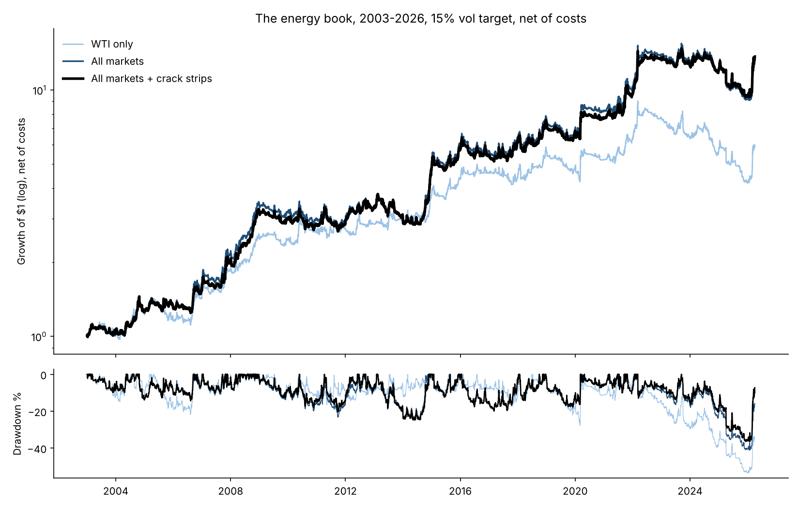

## Part 1. Forecasting the price

I took WTI crude oil futures (`CL=F`, Yahoo's continuous front-month series) and
compared an LSTM against an echo state network (ESN) reservoir model. My reasons
for choosing a recurrent architecture over feedforward and convolutional networks
are in [docs/METHODS.md](docs/METHODS.md), along with the gate equations and what
the reservoir is doing.

The first version compared the two models with each other and found that the LSTM
won. It did win, but I never checked either model against the obvious benchmark,
which is predicting that tomorrow's price is today's price. Both models lose to that
benchmark by a wide margin.

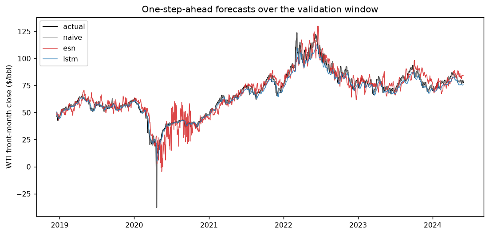

*The naive forecast is on this chart. It is the grey line, and you cannot see it
because it sits underneath the actual price for the whole window. That is the
problem with judging a one-step-ahead price model by eye.*

| | |
|---|---|
| Data | WTI front-month continuous (`CL=F`), 2000-08-30 to 2024-05-30, 5,962 daily closes |
| Models | Naive persistence, echo state network (ReservoirPy), stacked LSTM (TensorFlow) |
| Split | 75% train, chronological. Evaluation 2018-12-18 to 2024-05-30, 1,371 days |
| Task | One-step-ahead close, 120 trading days of memory |
| Metrics | RMSE, MAE, MASE, directional accuracy, skill against persistence |

### Results

| model | RMSE | MAE | MASE | directional accuracy | seconds |
|---|---|---|---|---|---|
| naive persistence | **2.71** | **1.36** | **1.35** | n/a | 0.0 |
| LSTM | 4.06 | 2.82 | 2.80 | 0.477 | ~94 |
| echo state network | 7.00 | 5.12 | 5.09 | 0.498 | ~0.05 |

Skill against persistence is −0.496 (RMSE) and −1.077 (MAE) for the LSTM, and
−1.580 and −2.766 for the ESN. Positive would mean an improvement.

The LSTM does beat the ESN, by about 42% on RMSE, so the original conclusion holds
that far. The reservoir fits in a twentieth of a second against the LSTM's ninety,
three orders of magnitude faster, which is the point of a fixed random reservoir
with a trained readout. Here it pays for that speed with a much noisier forecast.

Neither model beats doing nothing. Persistence gets an RMSE of 2.71 and the LSTM
4.06. A model that takes 94 seconds to train and forecasts worse than copying
yesterday's number is not one I would trade on. MASE says the same thing in
scale-free terms, with both models well above 1.

Neither model has directional skill either: 0.477 and 0.498 against a coin flip.
Level accuracy on a near-random walk is easy to get and says almost nothing,
because most of tomorrow's price is today's price. The direction of the move is
where the information is, and neither model has any.

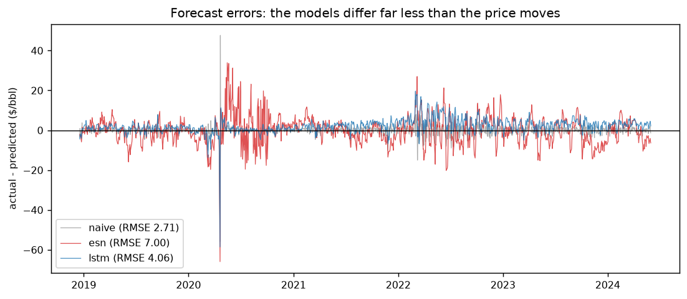

### Does the contract roll explain it?

`CL=F` splices onto the next contract when the front one expires. The change across
a splice mixes a real price move with the spread between two contracts, and no
model can forecast the spread part. I derived the roll dates from the CME contract
rule (three business days before the 25th of the month before delivery, or four if
that 25th is not a business day) instead of detecting them from jumps in the data.
The rule is checked against eight published termination dates in the tests.

Roll days are 285 of 5,961 (4.8%), and 66 of them fall in the evaluation window.
They are more volatile than other days ($1.34 against $1.07 mean absolute change,
1.24 times as much) but carry only 5.3% of total variance. Removing them barely
moves the result: LSTM skill goes from −0.496 to −0.485 and ESN skill from −1.580 to
−1.528. The roll is not what makes the comparison hard. The task is: predicting one
step ahead on something close to a random walk, where the benchmark is already most
of the way to the answer.

I had assumed the −$37.63 close on 2020-04-20 was a roll artefact. It is not. It
falls the day before that contract's termination, and FRED's Cushing spot price,
which has no contract and no roll, went negative the same day at −$36.98. That was
a real collapse in the expiring contract under a storage shortage, and no model here
saw it coming.

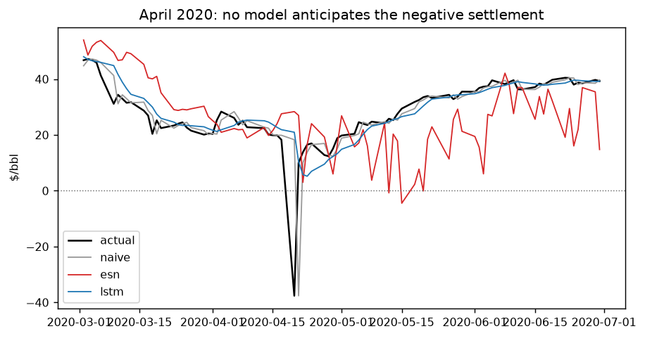

### Returns, scored once on unseen data

Predicting the price level cannot beat persistence, so I moved to returns.
[docs/PROTOCOL.md](docs/PROTOCOL.md) fixed the test before any return model was
fitted:

- Train to 2014, choose hyperparameters and a shrinkage weight on 2015-2018, then
  score 2019-01-02 to 2024-05-30 once, with expanding-window refits each quarter.
- Models predict the h-day log return, and price = last × exp(r̂), so r̂ = 0 is
  persistence exactly.
- Horizons are 1, 5 and 20 days, with only non-overlapping targets scored for h > 1.
- Skill is 1 − RMSE/RMSE of persistence, the Diebold-Mariano (DM) test uses a
  Newey-West variance, and directional accuracy gets a two-sided binomial test.

| h | model | n | RMSE | skill | DM p | dir. acc. | binomial p |
|---|---|---|---|---|---|---|---|
| 1 | persistence | 1359 | 1.851 | 0 | | | |
| 1 | random walk + drift | 1359 | 1.851 | −0.0002 | 0.570 | 0.536 | 0.009 |
| 1 | ridge (k=1, alpha=0.01) | 1359 | 1.852 | −0.0008 | 0.261 | 0.500 | 1.000 |
| 5 | persistence | 272 | 4.055 | 0 | | | |
| 5 | random walk + drift | 272 | 4.058 | −0.0007 | 0.625 | 0.529 | 0.363 |
| 5 | ridge (k=20, alpha=100) | 272 | 4.055 | +0.0002 | 0.388 | 0.559 | 0.060 |
| 20 | persistence | 68 | 7.793 | 0 | | | |
| 20 | random walk + drift | 68 | 7.812 | −0.0025 | 0.673 | 0.485 | 0.904 |
| 20 | ridge (k=1, alpha=0.01) | 68 | 7.832 | −0.0049 | 0.060 | 0.471 | 0.716 |

Nothing beats persistence significantly. The largest skill is +0.02% at five days,
with a DM p-value of 0.39. The one small directional p-value belongs to the drift
baseline at one day, and it always calls "up", so it is scoring the share of up days
(53.6%) and not forecasting anything. The fitted shrinkage weight was 1.0 at every
horizon, so the combined forecast equals the ridge. The ridge's small edge on the
validation years (+0.26% skill at one day) did not carry over. Trading the sign of
the one-day forecast, with 2bp a side and a close-and-reopen on roll days, made −3.2%
a year gross and −8.7% net, a Sharpe of −0.17.

48 configurations were tried (15 ridge settings × 3 horizons, plus the drift
baseline). The holdout was run once. Permuted returns give skill at or below zero
across ten seeds, a planted AR(1) signal is found, and forecasts made at a date do
not change when later prices change (`tests/test_forecast.py`). Reproduce with
`python run.py --holdout`.

### Second attempt: spread, basis and the dollar

[docs/PROTOCOL-2.md](docs/PROTOCOL-2.md) was committed before any data after May
2024 was downloaded. It set a fresh holdout (2024-06-03 to 2026-10-08, 591 one-day
targets, scored once) and six candidates chosen on economic grounds: the Brent-WTI
spread, the spot-vs-front basis, the dollar index and combinations of them, all
lagged one day, from FRED's `DCOILBRENTEU`, `DCOILWTICO` and `DTWEXBGS`. Ridge
shrinkage was strong (alpha = 1000) and the Bonferroni threshold was 0.05/6 = 0.0083.

The validation weight came out at 0 for all six. On 2019-2024 every candidate's
forecast was uncorrelated or slightly anti-correlated with the next return
(correlations between −0.056 and −0.003), so the pre-declared forecasts were
persistence exactly. To still look for signal, the table shows the unshrunk
forecasts, a diagnostic added after seeing that result:

| model | RMSE | skill | DM p | dir. acc. | binomial p | sign strategy, net a year and Sharpe |
|---|---|---|---|---|---|---|
| persistence | 2.311 | 0 | | | | |
| random walk + drift | 2.311 | −0.0001 | 0.653 | 0.519 | 0.387 | |
| C1 spread | 2.311 | +0.0000 | 0.982 | 0.503 | 0.902 | −6.6%, −0.15 |
| C2 basis | 2.312 | −0.0003 | 0.127 | 0.473 | 0.202 | −46.8%, −1.07 |
| C3 dollar | 2.311 | +0.0003 | 0.431 | 0.554 | 0.0094 | +56.7%, +1.30 |
| C4 spread + basis | 2.312 | −0.0005 | 0.781 | 0.507 | 0.773 | +6.4%, +0.14 |
| C5 spread + basis + dollar | 2.312 | −0.0002 | 0.900 | 0.536 | 0.091 | +38.0%, +0.87 |
| C6 all + last return | 2.309 | +0.0008 | 0.685 | 0.524 | 0.266 | −3.4%, −0.08 |

No candidate is significant. The dollar index is the tempting row, with 55.4%
directional hits (p = 0.0094, just above the threshold) and a 1.3 Sharpe sign
strategy. But its RMSE skill is +0.03% with a DM p-value of 0.43, its validation
weight was 0, its Sharpe has a standard error near 0.65 over 2.4 years, and it is the
best of six. I read it as a lead for a future sample and did not tune anything
around it. Reproduce with `python run.py --holdout2`.

The conclusion of Part 1: against its own past returns (2019-2024) and against the
Brent-WTI spread, the spot basis and the dollar (2024-2026), the next-day WTI
front-month price does not beat persistence, and no directional edge survives the
multiple-testing correction. The samples are short and only linear models were
tried, so this is evidence and not proof.

## Part 2. Trend, carry and volatility targeting

Part 1 asked what tomorrow's price will be, and the answer was today's price.
Systematic futures traders mostly ask what position to hold, given what the market
already shows. That does not need a next-day forecast. So I ran the three rules
behind most CTA books on WTI, Brent, RBOB and heating oil from 2001 to October 2026,
rebalanced monthly, net of 2bp a side plus a close-and-reopen on every roll:

- Trend: long or short on the sign of the trailing 1, 3 or 12-month return
  (time-series momentum, Moskowitz, Ooi and Pedersen 2012).
- Carry: long in backwardation, short in contango.
- Volatility targeting: scale any position to 20% annual volatility (EWMA,
  60-day centre of mass).

WTI, 2001-08 to 2026-10, all vol-targeted except the first row:

| rule | Sharpe | annual return | max drawdown |
|---|---|---|---|
| buy and hold | 0.34 | 13.7% (40% vol) | −94% |
| buy and hold, vol-targeted | 0.26 | 5.3% | −72% |
| trend 1m | 0.35 | 7.1% | −41% |
| trend 12m | 0.21 | 4.2% | −66% |
| carry, front vs spot | −0.22 | −4.5% | −92% |
| **carry, next contract vs front** | **0.49** | **9.9%** | **−41%** |
| trend 12m + carry | 0.48 | 7.2% (15% vol) | −31% |

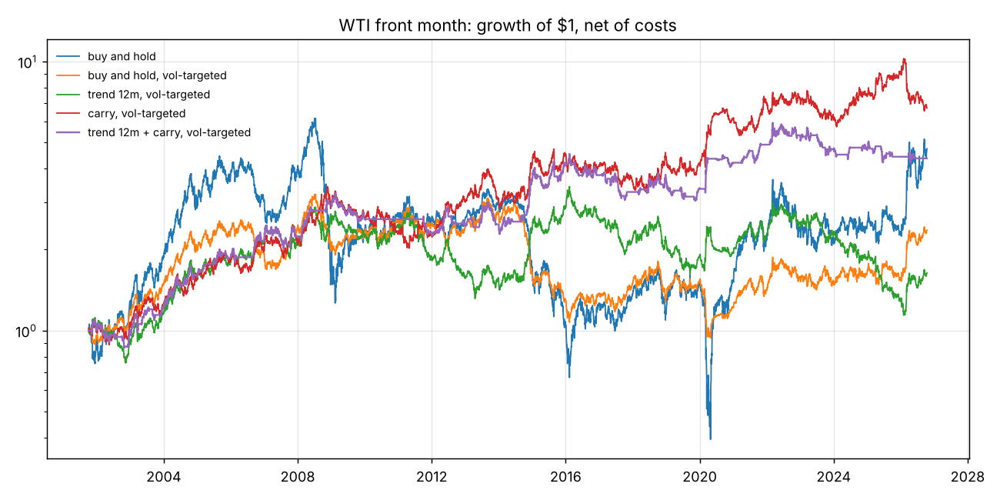

You can forecast the size of tomorrow's move but not its direction. Daily return
autocorrelation is about −0.02 at every lag on all four contracts. The
autocorrelation of the absolute return is 0.17 to 0.25 at one day and still 0.13 to
0.16 at a month. That is the case for volatility targeting, and the reason a
price-level model had nothing to find.

Carry works once it is measured on the right part of the curve. My first version
used the futures-minus-spot basis, the same feature that failed in Part 1, and it
lost money on every contract. The front month sits almost on top of spot for most of
its life, so that basis is mostly noise. The slope that matters is next contract
against front, and a continuous series contains it: on each roll day the basis jumps
by about log(next/front), because the series switches contracts while spot does not.
Measured that way, WTI carry has a 0.49 Sharpe, is positive in every regime I split
out, and is correlated −0.21 with buy and hold. Its best year is 2020, when it was
short through the super contango.

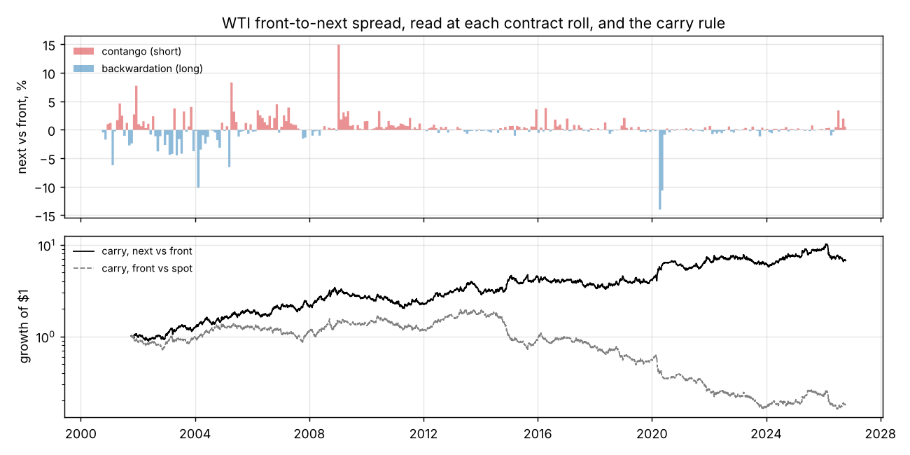

Single-contract trend is weak and unstable. 12-month trend on WTI makes 0.21, and the
lookback grid has no smooth ridge: neighbouring lookbacks swing from 0.38 to −0.07.
The Sharpe in the trend literature comes from diversifying across dozens of futures.
Where trend does earn is in big directional moves, 2014-2016 especially (0.95).

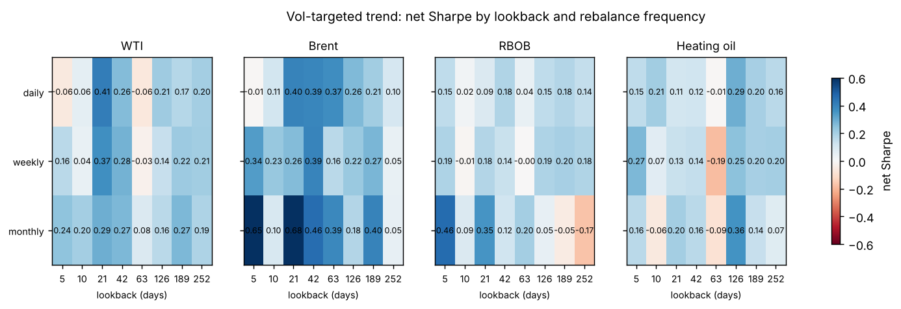

Volatility targeting halves the drawdown of a long oil position but does not raise
its Sharpe. It cuts exposure after a volatility spike, and in oil the spike comes
with both the crash and the rebound. In 2020 it was underweight for the recovery. For
trend and carry, whose returns do not depend on oil going up, it keeps position sizes
comparable through time. Trend 12m and carry are correlated 0.11, so the blend runs
at 15% volatility against a 20% target with a −31% drawdown, against −94% for buy and
hold.

Gasoline is different. RBOB's curve is seasonal because summer and winter blends
differ, so its contango and backwardation mostly follow the calendar. Carry is flat
there (−0.04) and 12-month trend loses (−0.18).

Notes:

- WTI splice days come from the CME rule in `roll.py`. RBOB and heating oil splice on
  the first trading day of each month, and Brent follows ICE's expiry rules before and
  after 2016. The basis moves 2.1 to 3.0 times more on splice days than other days for
  WTI, RBOB and heating oil, which confirms the calendars. For Brent it is only 1.3
  times, because FRED's Brent spot is Dated Brent, so the Brent rows in
  `results/strategies.json` are rough.
- Returns on splice days, and on 2020-04-20, are set to zero.
- A Sharpe ratio over 25 years has a standard error of about 0.2, and I ran about a
  dozen rules on four contracts, so gaps of 0.1 to 0.2 between rows are noise. The
  0.7 gap between the two carry measures is not.
- Data: Yahoo front-month closes (`CL=F`, `BZ=F`, `RB=F`, `HO=F`) and FRED spot
  prices (`DCOILWTICO`, `DCOILBRENTEU`, `DGASNYH`, `DHOILNYH`). Tests in
  `tests/test_strategies.py` check that no rule sees the future, that trend finds
  planted regimes and nothing in a random walk, and that the splice spread reads a
  known contract spread.

Reproduce with `python run_strategies.py`.

## Part 3. Virtual Barrels

The rules in Part 2 only use prices. Ilia Bouchouev's *Virtual Barrels* (2023)
argues that oil is now priced as much by financial barrels as by physical ones.
Storage hedgers, trend followers, slow inflation-hedging money and option sellers
each leave a footprint in the curve, the positioning data or the volatility surface.
I built one strategy family per footprint, from the book's chapters and the rules he
spells out in his *Energy Quantamentals* comments for the Oxford Institute for Energy
Studies.

That took more data than a front-month price: EIA's daily Cushing contracts 1-4 (the
curve, 2000 to April 2024, when EIA stopped publishing it), EIA weekly crude stocks,
CFTC disaggregated positions for NYMEX WTI and the CBOE OVX index. With four
contracts the roll is exact: the day after an expiry, yesterday's second contract is
today's first, so the held return is C1(t)/C2(t−1).

WTI, 2008 to April 2024, every strategy scaled to 15% volatility, net of costs:

| family | rule | Sharpe | max drawdown |
|---|---|---|---|
| benchmark | buy and hold (contract 2, rolled) | −0.12 | −71% |
| curve | carry: long backwardation, short contango | 0.45 | −28% |
| curve | **carry-momentum**: carry against its 1-month average | **0.61** | −28% |
| price | momentum M(1,20) | 0.15 | −48% |
| price | multi-horizon M(1,5)+M(5,20)+M(20,250) | 0.20 | −41% |
| price | M(1,20) sized by the reaction function | 0.25 | −26% |
| positioning | **follow the flow** (managed-money crossover) | **0.40** | −29% |
| positioning | fade the crowd (range extremes) | −0.04 | −21% |
| positioning | hedging pressure (Keynes premium) | −0.28 | −69% |
| inventories | **inventory cycle** (stocks against the 5-year seasonal norm) | **0.60** | −38% |
| inventories | squeeze spread: C2-C3 on Cushing fill | 0.16 | −28% |
| quantamental | WTI-Brent convergence | −0.49 | −72% |
| volatility | short one-month variance at OVX | 0.42 | −80% |
| book | all twelve, equal risk | 0.53 | −32% |
| book | simple: M(1,20) + carry | 0.40 | −44% |
| book | core four (bold rows, chosen after seeing this table) | 0.90 | −25% |

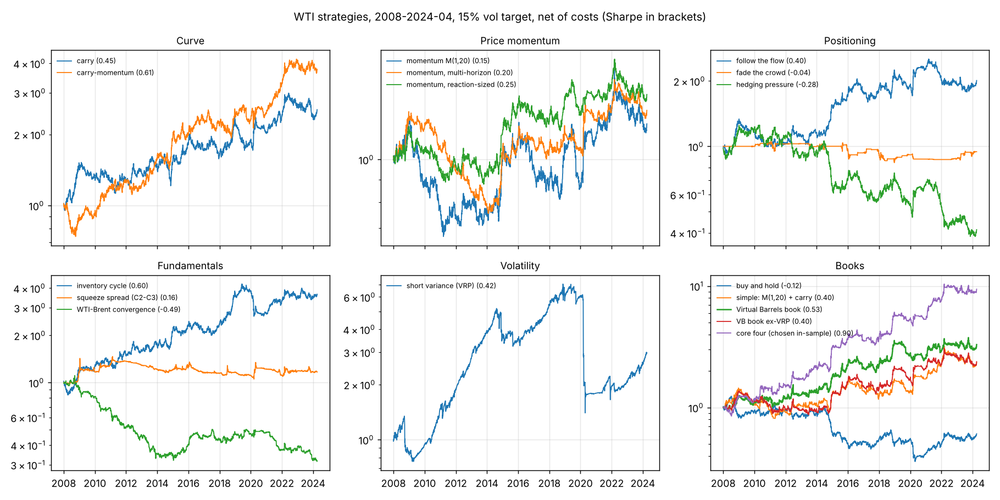

The curve carries most of the information, and its change carries more than its
level. Carry-momentum buys when backwardation is steepening or contango is
flattening. Bouchouev reports Sharpe ratios of 0.48 for carry and 0.63 for
carry-momentum on WTI over 1994-2023. I get 0.45 and 0.61 on a different window, and
all seven lookback pairs I tried land between 0.51 and 0.70. Inventory flows show up
in the curve before they show up in the outright price.

Price momentum alone is the weakest systematic rule (0.15). The reaction function,
which builds the position up to one standard deviation of the signal and then cuts
it, barely changes the Sharpe (0.25) but halves the drawdown, because it stops adding
to a move that is already stretched.

In positioning, the information is in the flow. Following the managed-money crossover
earns 0.40, and all sixteen parameter pairs are positive. Fading the crowd at range
extremes is a coin flip across its twenty parameter sets, which matches Bouchouev's
finding up to about 2022. The classic hedging-pressure premium (long when producers
and swap dealers are unusually net short) loses. In WTI those shorts are mostly swap
dealers hedging shale producers' OTC trades, and the level moves slowly against a
market the funds are already trading.

Inventories work through the seasonal surplus. Going long when US crude stocks are
drawing relative to the five-year same-week average earns 0.60, and is positive in
every period except 2020, when stocks built faster than ever and prices recovered
anyway. The Cushing squeeze trade (short the C2-C3 spread when Cushing fills near its
recent maximum, long when it drains) is weak at 0.16 because the extremes it is built
for, like April 2020, are rare.

WTI-Brent does not mean-revert on a three-month horizon. The spread trended through
every structural change in the period: the Cushing glut of 2011-13, the end of the US
export ban in 2015 and the pipeline build-out after it.

The volatility premium is real and dangerous. OVX averaged 39 against 35% realised
front-month volatility. Sold as one-month variance swaps and marked to market every
day, the premium earns 0.42 with a −80% drawdown, nearly all of it in 2020. My first
version (Sharpe 1.22) booked only the daily accrual. That hid the swings in implied
volatility, so the risk looked half as large and the sizing ran at the leverage cap.
An independent review of the code caught it.

The book beats its parts because the parts are nearly uncorrelated. The average
pairwise correlation across the twelve strategies is 0.07, and carry,
carry-momentum, the inventory cycle and following the flow are correlated 0.10 to
0.22 with each other. An equal-risk book of all twelve has a 0.53 Sharpe and a −32%
drawdown, against −71% for buy and hold. Keeping only the four strong families gives
0.90, but I chose that book by looking at the table, so 0.90 is an upper bound.

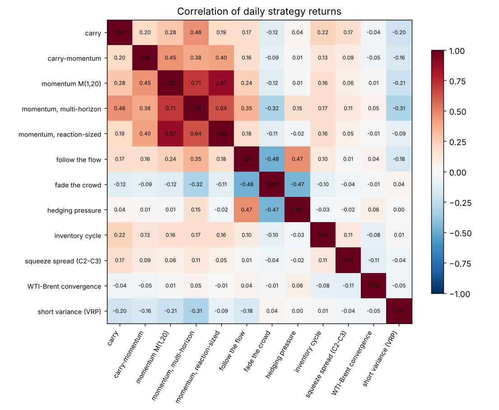

Notes:

- A signal from data known at the close of day t sets the position for day t+1. COT
  reports (as of Tuesday) come out Friday at 3:30pm ET, after the oil settlement, so
  they are first used at Monday's close. EIA weekly stocks are first used at
  Thursday's close. Rerunning everything with data cut at three dates changes no
  earlier return.
- Costs: 2bp a side on outrights plus a full roll each month, 4bp on spreads, 1 vol
  point of bid-ask per variance swap and 2bp on each monthly re-sizing.
- OVX is implied volatility on USO options, a proxy for options on the WTI future,
  and a variance swap at OVX is not tradeable at that level. Cushing utilisation uses
  stocks over their trailing three-year maximum, because EIA's capacity survey is
  semi-annual.
- Tests in `tests/test_virtual_barrels.py` cover the roll mapping, carry sign and
  scale, the reaction function, COT and EIA release timing, Good Friday rolls,
  variance-swap settlement and that carry and carry-momentum find nothing on a
  random-walk curve.

Reproduce with `python run_virtual_barrels.py`.

## Part 4. Carry-momentum on raw contracts

Carry-momentum was the best rule in Part 3, but it ran on EIA's four-contract curve,
which stops in April 2024, and on 2008-2024 only. To test it properly I rebuilt the
curve from individual contracts and wrote the test down before looking at any data.

### The data

515,119 daily rows covering all 547 NYMEX WTI contract months since 1983, from LSEG
Datastream through WRDS, with settlement, volume and open interest for each contract.
Two independent checks:

- Rebuilt contracts 1-4 match EIA's published series to the cent on 99.6-99.8% of
  6,000 days (pass mark 99%). Getting there exposed a Datastream error: three 2007
  contracts carry last trading dates a month early, so expiries come from the CME
  rule.
- The roll-scheduled series tracks the S&P GSCI Crude Oil index with a daily
  correlation of 0.9992 and 1.4% a year tracking error over 2016-2026, outside April
  2020, when S&P changed the index roll by hand (pass marks 0.98 and 2%).

From that panel the code builds a constant-maturity curve (log-linear interpolation
at fixed days to expiry), rolls on the GSCI schedule (one fifth a day on business
days 5 to 9 of each month), and holds whole 1,000-barrel contracts. Every trade
executes at the next day's settlement and pays a tick, exchange and clearing fees and
half a tick to trade at settlement. Every roll is charged as a calendar spread.

### The pre-registered study

The protocol ([PROTOCOL.md](research/carry_momentum/PROTOCOL.md)) was committed
before any data was pulled. It fixed the signal (carry = ln(F1m/F13m), signal =
sign of carry minus its 21-day average), two instruments, the cost model, a trial
count and seven kill criteria. Every later change is logged with its reason in
[DEVIATIONS.md](research/carry_momentum/DEVIATIONS.md). The two instruments, both on a
$10m book at 15% volatility:

- H1, a calendar spread: long the 2nd listed contract, short the 7th.
- H2, an outright: long or short the 2nd listed contract.

| | H1 spread | H2 outright |
|---|---|---|
| Net Sharpe, 1990-2026 | −0.18 | 0.44 |
| Net Sharpe, 2003-2026 | −0.14 | 0.48 |
| Before costs, 1990-2026 | 0.36 | 0.54 |
| Costs, % of capital a year | 8.6 | 1.6 |
| 90% bootstrap interval for Sharpe | −0.50 to 0.15 | 0.15 to 0.72 |
| Deflated Sharpe (198 trials) | 0.00 | 0.37 |
| Probability of backtest overfitting, 24 variants | 0.14 | 0.49 |
| Alpha after WTI and AQR factors (t) | −4.8% (−1.77) | 4.8% (1.91) |
| Return from spot moves / from the curve | 0 / 5.8% | 6.7% / 1.8% |
| Capacity, worst day / 95th percentile day | $0.1m / $1.0m | $3.7m / $25m |

The curve signal in the spread is real, but the spread cannot pay for it. Before
costs it earns 5.8% a year with a 0.36 Sharpe, all from the curve. A 21-day carry
signal flips about 26 times a year, and a spread has so little dollar volatility that
a 15% target means 400-500 spreads. With rolls that is 75,000 contracts a year, and
costs take 8.6 points.

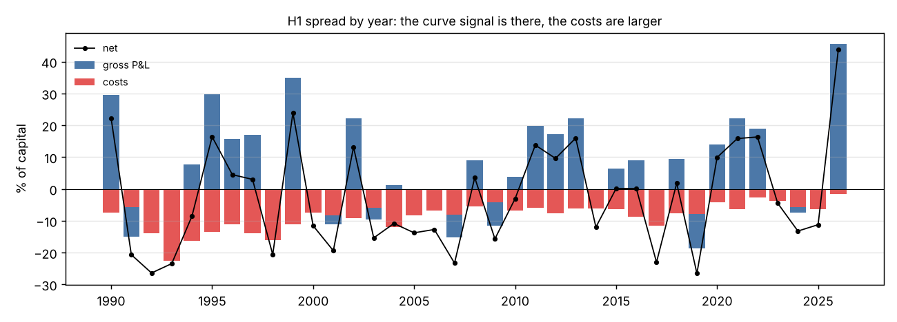

The outright works, mostly as a price bet. 6.7 of its 8.4 points of gross return come
from spot moves. It replicates the Part 3 result (0.53 on the same window) and holds
up before 2008 (0.43). It fails three of the kill criteria. The deflated Sharpe counts
every configuration ever run in this repository, and the alpha t-stat of 1.91 falls
just short of 2 after controlling for plain carry, to which it loads 0.26. The third
is capacity on the worst 1990s day. Started in 2003, after the thin pit-traded years,
the outright's Sharpe rises to 0.48 and its worst-day capacity to $15m.

Bouchouev's storage-hedger mechanism does not show up in the data. If hedgers drive
the curve, a rise in producers' and merchants' net short should deepen contango the
next week. The coefficient has the wrong sign (+0.05, t = 0.30, 1,032 weeks).

An independent audit of the code found no look-ahead and six issues, all fixed and
listed in DEVIATIONS.md. The one that mattered: the factors in the alpha test had
been built net of costs, which flattered the alpha. Built gross, the t-stat fell from
2.06 to 1.91. The rules are frozen at commit `dd460df`. The full note is
[NOTE.md](research/carry_momentum/NOTE.md).

## Part 5. The WTI curve strategy book

The study tested one signal under strict rules. Part 5 asks what a trading desk
would actually run. It changes three things:

- It starts in 2003, after the thin pit-traded market of the 1990s.
- Positions rebalance only when the target drifts more than 25% from the current
  holding, or when the signal flips, which cuts costs.
- The outright carry-momentum signal is combined with curve carry and trend in one
  risk-balanced book.

Everything else is the Part 4 machinery: whole contracts, next-day settlement, the
same costs and rolls. January 2003 to April 2026:

| Combined book | 15% vol target | 10% vol target |
|---|---|---|
| Annual return | **8.0%** | **5.7%** |
| Sharpe / Sortino | **0.56 / 0.74** | 0.57 / 0.76 |
| Growth of $1 | **$5.99** | $3.63 |
| Positive calendar years | **17 of 24** | 17 of 24 |
| Correlation to WTI | **−0.07** | −0.06 |
| Max drawdown | −53% | −39% |
| Best / worst month | +31% / −16% | +20% / −11% |

### The three strategies

| | Carry-momentum | Curve carry | Trend |
|---|---|---|---|
| Signal | Is backwardation getting steeper or flatter? | Is the curve backwardated or in contango? | 1, 3 and 12-month price direction |
| Annual return (net) | 6.6% | 6.2% | 2.6% |
| Sharpe | 0.49 | 0.46 | 0.27 |
| Max drawdown | −47% | −33% | −46% |
| Positive years | 16/24 | 15/24 | 13/24 |
| Costs a year | 0.9% | 0.2% | 0.5% |
| Position flips a year | 28 | 0.8 | 17 |
| Capacity, worst day / busy day | $15M / $85M | $51M / $112M | $42M / $180M |

Carry-momentum trades the change in the curve. When the 1-to-13-month spread steepens
into backwardation, prompt barrels are getting scarcer than the market had priced,
so it goes long. When the curve flattens toward contango, it goes short. It reacts
within days and tends to turn first in a crash, which is why it made +44% through
2014-16.

Curve carry trades the level of the curve. In backwardation a long position rolls up
the curve and earns the roll yield, and in contango a short does. A no-trade band
keeps it from flipping on noise, so it changes sides less than once a year and is
the cheapest strategy to run. Its best year was 2008 (+74%), short into the contango
after the crash.

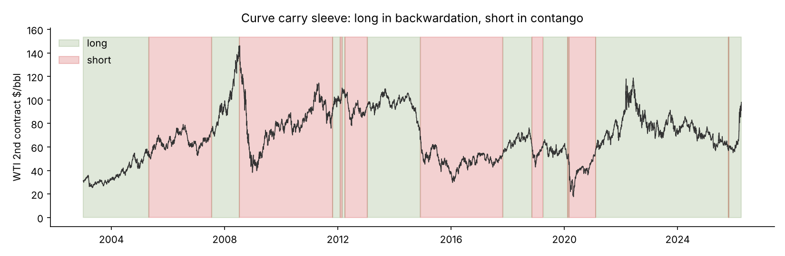

Trend is the standard CTA signal. It earns least alone but pays off in long moves,
with +51% through 2014-16 and +20% through COVID, when curve carry was flat.

Carry-momentum and curve carry are correlated 0.03, and carry-momentum and trend 0.29.
Weighting the three equally lifts the Sharpe from 0.46-0.49 for the best single
strategy to 0.56 for the book.

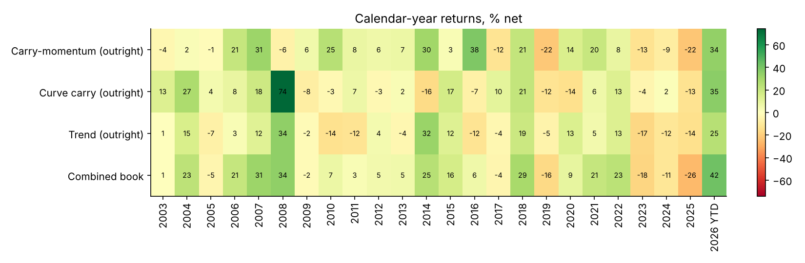

### Crashes and grinds

The book makes money when oil crashes and loses when oil grinds lower in steps.

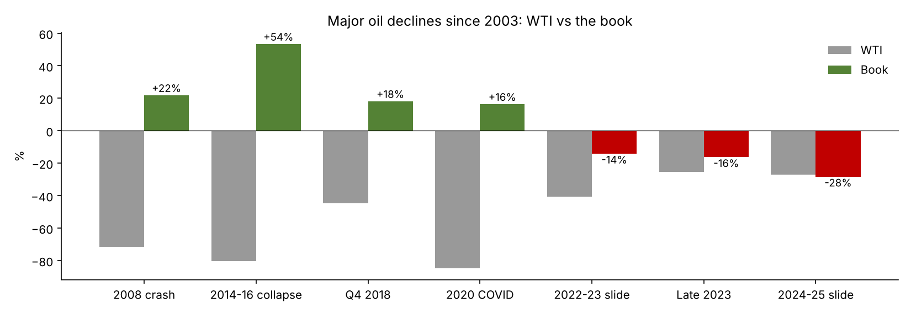

| Oil decline | WTI | Book | Carry-momentum | Curve carry | Trend |
|---|---|---|---|---|---|
| 2008 crash | −72% | **+22%** | +23% | +33% | +5% |
| 2014-16 collapse | −80% | **+54%** | +48% | −3% | +56% |
| Q4 2018 | −45% | **+18%** | +35% | +3% | +7% |
| 2020 COVID | −85% | **+16%** | +16% | −1% | +23% |
| 2022-23 slide | −41% | −14% | −14% | −15% | −9% |
| Late 2023 | −25% | −16% | −2% | −11% | −9% |
| 2024-25 slide | −27% | −28% | −15% | −16% | −16% |

It also made money in the two big rallies: +18% in the 2022 Ukraine spike and +33%
in the March 2026 supply shock. Averaged by month, the book earns +3.5% when WTI falls
more than 10% and +4.2% when WTI rises more than 10%, and gives a little back in
between. That is a long-volatility payoff, and it is why the book holds up in oil
shocks.

The 2022-25 declines were different from the crashes. OPEC+ cuts kept prompt barrels
tight while WTI fell from $120 to $60, so the curve stayed backwardated and curve
carry was long 99% of the time, collecting roll yield while losing more on price. The
fall came in steps with sharp rebounds, and each rebound caught trend and
carry-momentum short. The deepest drawdown ran from March 2022 to December 2025: −53%
at a 15% vol target and −39% at 10%. The book then made +42% in the first three months
of 2026.

Two fixes for the grind made it worse. Taking carry flat whenever trend disagreed
lost −40% over 2022-25 against −22% for plain carry. Dropping the 1-month part of
trend lost −51% against −42%. Both are logged and left out of the book.

### How it trades

- NYMEX CL, the 2nd listed contract, rolled one fifth a day on business days 5 to 9.
- Signals use day t's settlement. Trades go through at day t+1's settlement with
  trade-at-settlement orders.
- Each strategy targets 15% annual volatility on $10M, about 50-80 contracts. The
  book rescales the equal-weight blend to target on trailing one-year volatility.
- $16.50 per contract a side, and every roll charged as a calendar spread.

The calendar-spread version of carry-momentum did not make the book. Even with a
slower, banded signal it cost 2.8% a year against 1.2% gross, with $0.3M of capacity.
Every configuration run anywhere in this repository is in a trial ledger.
The full write-up with sizing, risk rules and capacity is
[BOOK.md](research/carry_momentum/BOOK.md).

## Part 6. The energy book: crude, gas and products

The WTI book's weak spot was one market grinding lower. Part 6 runs the same three
strategies, with the same engine, sizing, buffer and costs, on two layers of
markets:

- Core: WTI, ICE Brent and Henry Hub natural gas, the primaries.
- Downstream: NYMEX heating oil (ULSD), NYMEX gasoline (unleaded until 2006, then
  RBOB), ICE low-sulphur gasoil, Rotterdam 3.5% fuel oil and Mont Belvieu propane.
  These are traded outright first, then as spreads against crude
  ([below](#spreads-cracks-brent-wti-and-the-diesel-arb)).

All contracts come from Datastream through WRDS, like WTI: about 720,000
contract-days across 13 contract families, cut to the contracts within 15 months of
delivery (16 for Brent). NYMEX
expiries come from the exchange rules (they match Datastream on 97-99% of
contracts) and ICE expiries from Datastream. The ICE rows start in September 2003,
and the book stops on 2 April 2026, when the NYMEX rows end. On a day one exchange
is shut, that market counts as zero P&L.

Several products on WRDS barely trade, so I left them out: European jet kerosene
(median daily volume 0), Mont Belvieu physical ethane (one contract listed a day),
and the Mont Belvieu ethane, butane and natural gasoline swaps, which stop in 2015.
Fuel oil and propane are cleared monthly swaps, so I costed them at a realistic half
spread ($0.25 a tonne and 0.17 cents a gallon) instead of the exchange's minimum
tick.

A market joins the tradeable books only if all three of its strategies could run a
$10M book on a typical busy day since 2010 (5% of volume, 2% of open interest). I
added this rule after the first run showed that fuel oil and propane had almost no
capacity. It looks at capacity only: fuel oil, which made money, fails it along with
propane, which did not. Both are reported but kept out of the tradeable books.

### Each market

| Market | Data from | Annual return | Sharpe | Max drawdown | Positive years | Costs a year | Capacity, busy day since 2010 |
|---|---|---|---|---|---|---|---|
| WTI | 1983 | 8.0% | 0.56 | −54% | 17/24 | 0.6% | $199M |
| Brent | 2003 | 7.7% | 0.54 | −61% | 13/24 | 0.5% | $221M |
| Natural gas | 2000 | 4.6% | 0.36 | −51% | 16/24 | 0.7% | $55M |
| Heating oil | 2000 | 10.5% | 0.70 | −34% | 15/24 | 0.2% | $55M |
| Gasoline | 2000 | 5.1% | 0.40 | −44% | 15/24 | 0.2% | $63M |
| Gasoil | 2003 | 10.7% | 0.70 | −51% | 16/24 | 1.3% | $121M |
| Fuel oil (thin) | 2005 | 5.1% | 0.39 | −42% | 13/22 | 2.0% | $0M |
| Propane (thin) | 2009 | −1.7% | −0.01 | −69% | 8/18 | 4.8% | $0M |

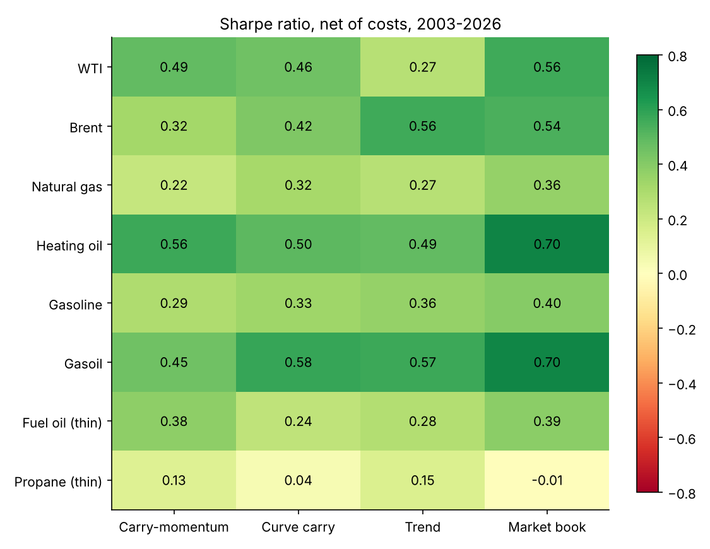

The distillates are the best markets in the project. Heating oil and gasoil each make
a 0.70 Sharpe, and all three strategies work on both, between 0.45 and 0.58. Diesel
inventories have a strong seasonal cycle and draw down hard in shortages, which gives
the curve strategies more to read. Brent's trend strategy (0.56) is twice as good as
WTI's (0.27).

### The books

| | WTI only | Core book | Downstream book | All markets |
|---|---|---|---|---|
| Markets | WTI | WTI, Brent, natural gas | Heating oil, gasoline, gasoil | All six |
| Annual return | 8.0% | 9.9% | 10.6% | **11.4%** |
| Sharpe / Sortino | 0.56 / 0.74 | 0.67 / 0.90 | 0.71 / 0.93 | **0.76 / 1.02** |
| Growth of $1 | $5.99 | $9.36 | $11.06 | **$13.03** |
| Max drawdown | −54% | −46% | −38% | −41% |
| Longest drawdown | 1,023 days | 987 days | 1,529 days | **658 days** |
| Positive years | 17/24 | 16/24 | 16/24 | 15/24 |
| Correlation to WTI | −0.06 | −0.04 | 0.06 | 0.02 |
| June 2022 to December 2025 | −50% | −44% | −23% | −37% |

Each book weights every market and strategy equally and targets 15% volatility. The
all-markets book makes 3.4 points a year more than the WTI book, with a drawdown 12
points smaller and less than two thirds as long. Adding fuel oil and propane would
lower its Sharpe to 0.74 and deepen its drawdown to −50%.

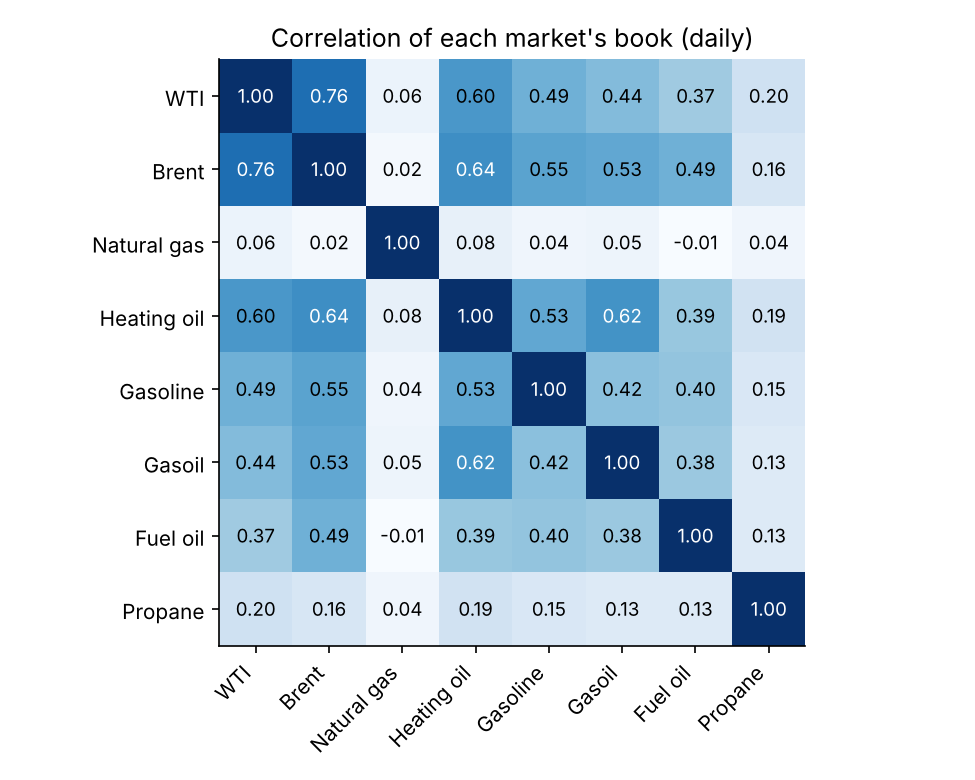

Natural gas is the real diversifier. Its book is correlated 0.02 to 0.08 with every
oil market. The tradeable oil markets are correlated with each other at 0.42 to 0.76, so the
products add less than their number suggests.

### Did more markets fix the grind?

Partly. Over June 2022 to December 2025 the all-markets book lost 37% against 50% for
WTI alone.

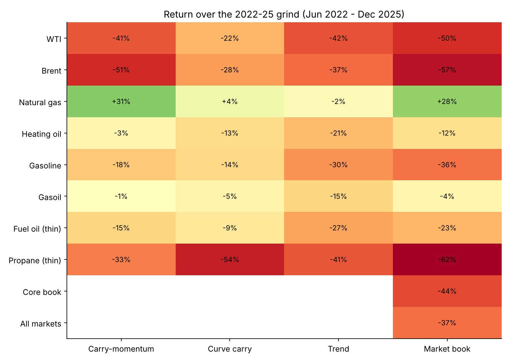

The loss was spread across the whole crude complex: Brent −57%, gasoline −36%. The
distillates held close to flat (heating oil −12%, gasoil −4%). Their curve and trend
moved more cleanly through the 2022 diesel shortage and its unwinding than crude's. Natural gas made +28%,
mostly from carry-momentum (+31%), as gas fell from about $9 to about $2.
One gas market against five oil markets was not enough to offset the oil losses.

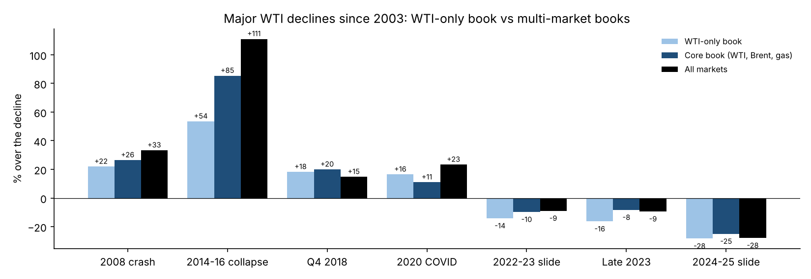

In the crashes, more markets made the book stronger. Through 2014-16 the
all-markets book made +111% against +54% for WTI alone, through 2008 +33% against
+22%, and through COVID +23% against +16%.

### Spreads: cracks, Brent-WTI and the diesel arb

An outright heating oil position is mostly a bet on crude, because diesel and crude
move together. What a refiner or a products desk trades is the margin between them.
So I built six spreads, each holding the same delivery month in every leg at
exchange ratios:

| Spread | Legs per unit |
|---|---|
| Heating oil crack | +1 heating oil, −1 WTI |
| Gasoline crack | +1 RBOB (unleaded before 2006), −1 WTI |
| 3-2-1 crack | +2 RBOB, +1 heating oil, −3 WTI |
| Gasoil crack | +4 gasoil (about 2,980 bbl), −3 Brent |
| Brent-WTI | +1 Brent, −1 WTI |
| Diesel arb | +4 gasoil, −3 heating oil |

Each spread runs four strategies. Three are the book's, applied to the spread itself:
curve carry on the spread's own curve, carry-momentum, and trend on the spread's P&L.
The fourth is seasonal mean reversion, which fades the margin when it is far from its
average for that calendar month over the previous five years.

I costed them two ways. Legged, each leg pays its full outright cost, which is
conservative. Listed, the spread trades as one exchange instrument at one $0.01/bbl
tick plus fees on every lot. I added the listed version after seeing the legged
results, so both are logged as separate trials.

| Spread | Annual return, legged | Sharpe, legged | Best strategy before costs | June 2022 to December 2025 |
|---|---|---|---|---|
| Heating oil crack | −0.3% | 0.06 | trend, 0.33 | −36% |
| Gasoline crack | −2.5% | −0.09 | curve carry and trend, 0.28 | −30% |
| 3-2-1 crack | −0.4% | 0.05 | trend, 0.39 | −6% |
| Gasoil crack | −3.5% | −0.16 | carry-momentum, 0.33 | −17% |
| Brent-WTI | −5.6% | −0.27 | trend, 0.30 | −63% |
| Diesel arb | −10.4% | −0.64 | none above 0.05 | −38% |

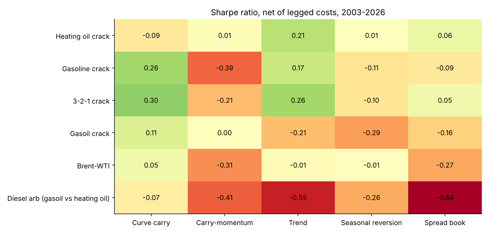

| | Core outright book | Spread book, legged | Spread book, listed | Core + spreads, legged | Core + spreads, listed |
|---|---|---|---|---|---|
| Annual return | 9.9% | −3.5% | 0.8% | 4.2% | 7.9% |
| Sharpe | 0.67 | −0.24 | 0.13 | 0.34 | 0.56 |
| Max drawdown | −46% | −71% | −53% | −61% | −56% |
| June 2022 to December 2025 | −44% | −37% | −27% | −60% | −54% |

The spreads do not work with these signals. The checks behind that: every leg holds
the same delivery month, and the engine's daily P&L matches a hand calculation from
the raw settlements to the dollar. What the results show:

- The edge before costs is small. The best strategies are trend and curve carry on
  the gasoline and 3-2-1 cracks, and trend on Brent-WTI, at Sharpe ratios of 0.28 to
  0.39 before any cost. A spread moves less than either leg, so the 15% target needs
  more contracts, and costs take most of what is left.
- Carry-momentum fails on spreads (−0.43 across all six), for the same reason the WTI
  calendar spread failed in Part 4: on a low-volatility spread it flips too often to
  pay for itself.
- Seasonal mean reversion fails too. Margins did not return to their same-month
  norms over 2003-2026. A likely reason is that they shifted for years at a time, as
  with the WTI discount after the shale boom from 2011 and the diesel shortage of
  2022.
- The diesel arb between New York and Europe has no edge at all.
- The spread book is uncorrelated with the outright core (0.02), but it is too weak
  to help. Adding it lowers the core book's Sharpe from 0.67 to 0.34 legged, or 0.56
  listed, and makes 2022-25 worse (−54% to −60% against −44%).

So the outright product books in the tables above make money mostly because they
carry crude's direction plus each product's own trend. The margin on its own is much
harder to predict from prices alone. The natural next test for the cracks is
fundamental: EIA's weekly distillate and gasoline stocks against their seasonal norm,
the same inventory-cycle idea that made a 0.60 Sharpe on WTI in Part 3.

### Cracks traded like a products desk

The spread test above applied the outright machinery mechanically. That is not how
cracks are traded. So I rebuilt the three NYMEX cracks (heating oil, RBOB and 3-2-1)
the way a products desk runs them, and committed the rules
([CRACKS_PROTOCOL.md](research/carry_momentum/CRACKS_PROTOCOL.md)) before running
anything:

- Seasonal strips on a fixed calendar every year: long the December-February heating
  oil crack from August to October, ahead of the heating season, and long the
  May-August RBOB crack from January to March, ahead of the driving season. The
  3-2-1 runs both.
- An inventory signal on the prompt crack: long when US distillate or gasoline stocks
  are more than half a standard deviation below their five-year average for that
  week, short when above. Each EIA report is used on the Thursday after its
  Wednesday release.
- A risk budget set once a year (10% volatility on $10M from three years of
  history) instead of a daily volatility target, and listed-spread costs.
- 2006 to April 2026, NYMEX only, so every leg settles at the same time and RBOB is
  used throughout.

| | Seasonal strips | Inventories |
|---|---|---|
| Heating oil crack | 1.1% a year, Sharpe 0.20, 10 of 20 trades won | −0.9%, 0.01 |
| RBOB crack | 2.4% a year, Sharpe 0.45, 15 of 21 trades won | −3.8%, −0.38 |
| 3-2-1 crack | 3.3% a year, Sharpe 0.46, 23 of 41 trades won | −5.2%, −0.47 |
| June 2022 to December 2025 | +21%, +9%, +17% | −6%, −12%, −6% |

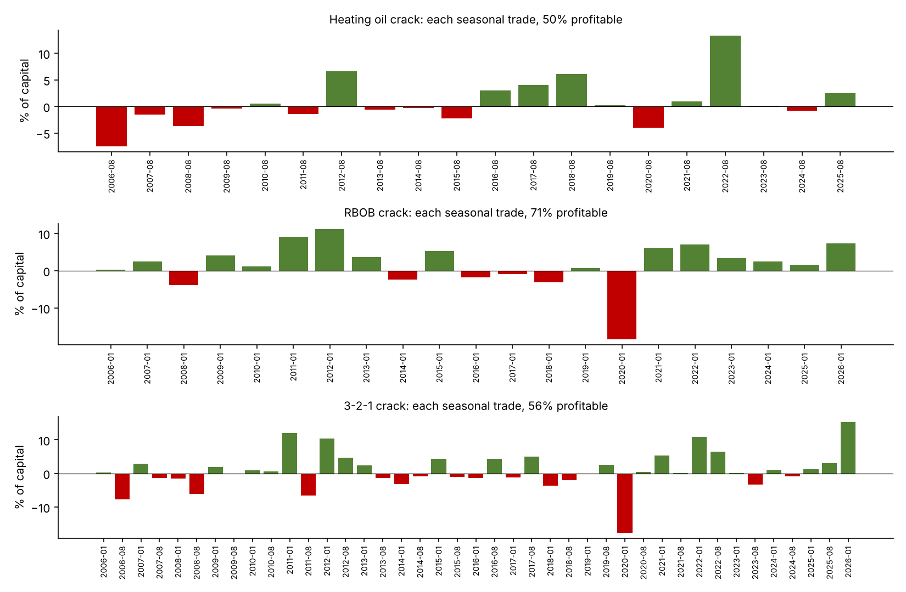

The seasonal strips work, and they made money through 2022-25, the stretch that hurt
every other book here. Their annual returns are small because they are in the market
only a quarter of the year (half for the 3-2-1). The RBOB trade is the strongest: 15
of 21 years were profitable, and the one large loss was 2020 (−18.5%), when COVID
emptied the roads during the window.

The inventory signal fails on all three. Low stocks did not lead to wider cracks a
week later. One reading is that by the time EIA publishes, the curve has already
moved.

Cracks roughly tripled over 2006-2026, so a long-only trade could be riding that
drift. Two placebos, added after the first run and logged as
trials, separate the two:

| | Actual strips | Same strips, 3 months earlier | Long the prompt crack all year |
|---|---|---|---|
| Heating oil crack | 5.1% a year in the market | 2.8% | 4.1% |
| RBOB crack | 10.1% | 0.1% | 5.1% |
| 3-2-1 crack | 7.1% | 1.0% | 5.7% |

Per year actually in the market, the RBOB window earns twice the passive drift, and
the same trade three months earlier earns nothing. That is a real seasonal effect.
The 3-2-1's edge over the drift is smaller, and the heating oil winter trade is
mostly drift. Holding the prompt crack long all year would have had a Sharpe of 0.28
to 0.49 by itself, which is the refiner's margin rising over these twenty years.

As a book, the inventory losses outweigh the strips: −2.3% a year (Sharpe −0.14), and
it lowers the core book when combined. The usable result is narrower. The summer
RBOB and 3-2-1 strips earn a seasonal premium while in the market only part of the
year, and they made money through 2022-25.

### The final energy book

So the strips go into the book. I committed the rule before running it (the addendum
to the crack protocol): the three seasonal strip strategies, exactly as tested and
with none dropped, join the 18 outright sleeves of the all-markets book. All 21 are
weighted equally and the book is scaled to 15% volatility as before. The inventory
strategy stays out.

| | WTI only | All markets | All markets + crack strips |
|---|---|---|---|
| Annual return | 8.0% | 11.4% | **11.6%** |
| Sharpe / Sortino | 0.56 / 0.74 | 0.76 / 1.02 | **0.79 / 1.06** |
| Growth of $1 | $5.99 | $13.03 | **$13.68** |
| Max drawdown | −54% | −41% | **−37%** |
| Longest drawdown | 1,023 days | 658 days | 658 days |
| Positive years | 17/24 | 15/24 | 16/24 |
| June 2022 to December 2025 | −50% | −37% | **−31%** |
| 2014-16 collapse | +54% | +111% | +104% |


The strips are correlated 0.08 with the rest of the book. Three sleeves out of 21,
in the market for part of each year, move the totals a little: 0.2 points of return,
0.03 of Sharpe. They do most of their work where the book was weakest, cutting the
2022-25 loss by six points and the worst drawdown by five. They give up a little in
the big trending crashes, where the outright sleeves were already doing the work.

The inventory signal is the open item. EIA's weekly numbers are national totals from
a survey, published with a lag. A desk would use regional and closer-to-real-time
data (New York Harbor and Gulf Coast product stocks, ARA storage, tank and satellite
counts), which is paid data I do not have here.

Notes:

- The outright run added 28 configurations to the trial ledger before running (24
  market and strategy pairs and four books), the spreads added 52 (24 spread and
  strategy pairs at each cost basis, and four books), and the crack rebuild added 17
  (nine strategies, two books and six placebos), and the final book one more. The
  ledger now holds 352.
- The markets and strategies were fixed before any multi-market result was seen.
  The liquidity rule came after the first run, as described above, and no market was
  dropped for its returns.
- Rerunning the WTI market through the multi-market code reproduces Part 5 exactly.

Reproduce with `python multi.py`, `python spreads.py`, `python cracks.py` and
`python energy_book.py` (one to three minutes each, writing to
`research/carry_momentum/results/`).

## Decisions that run through the project

- Persistence is the first benchmark. Comparing two models with each other says
  which is better. It does not say whether either is any good.
- MASE replaces MAPE. A percentage error needs a positive denominator, and WTI
  closed at −$37.63.
- Roll dates come from exchange rules. Detecting jumps and calling them rolls
  would fit the diagnosis to the symptom.
- Tests are written before results. Both forecasting holdouts and the
  carry-momentum study were committed to GitHub before the data they score was
  touched, and each was scored once.
- Every configuration is counted. The trial ledger feeds the deflated Sharpe, so
  a good result found after many tries is discounted for the search.
- Signals use only what was known at the previous close, checked by rerunning
  with data cut at fixed dates.
- Everything is seeded. Two runs give the same numbers.

## Quick start

```bash
pip install -r requirements-dev.txt
pytest tests research/carry_momentum/tests -q   # 96 tests, no network
```

| Part | Code | Run |
|---|---|---|
| 1. Forecasting | `data.py`, `models.py`, `forecast.py`, `metrics.py`, `roll.py` | `python run.py` (add `--holdout`, `--holdout2` or `--no-lstm`) |
| 2. Trend, carry, vol | `strategies.py` | `python run_strategies.py` |
| 3. Virtual Barrels | `virtual_barrels.py` | `python run_virtual_barrels.py` |
| 4. Curve and study | `research/carry_momentum/curve.py`, `reconcile.py`, `engine.py`, `study.py` | `python reconcile.py`, `python study.py` |
| 5. Book | `research/carry_momentum/book.py` | `python book.py` (about a minute) |
| 6. Energy book | `research/carry_momentum/markets.py`, `multi.py`, `spreads.py`, `cracks.py`, `energy_book.py` | `python multi.py`, `python spreads.py`, `python cracks.py`, `python energy_book.py` |

- Parts 1-3 download from Yahoo, FRED, EIA and CFTC on the first run and cache
  locally.
- Parts 4-6 need the Datastream contract files, which are licensed through WRDS and
  not committed. [DATA.md](research/carry_momentum/DATA.md) says how to rebuild them.
- `study.py` also needs the private capstone validation library. `book.py` and
  `multi.py` run without it.
- Two extra smoke tests run the LSTM and reservoir when TensorFlow and ReservoirPy are
  installed.

Results quoted here are tracked in `results/` and `research/carry_momentum/results/`.
`docs/METHODS.md` is my original write-up of the networks, and `legacy/` holds the
original script, annotated.

## Sources

- Ilia Bouchouev, *Virtual Barrels: Quantitative Trading in the Oil Market*
  (Springer, 2023).
- Ilia Bouchouev, *Energy Quantamentals* comments, Oxford Institute for Energy
  Studies: "Myths and Realities about CTAs" (2024), "Who is who in Financial Barrels"
  (2024), "The Revival of the Volatility Risk Premium" (2025), "A Tale of Two
  Algorithms and OPEC+" (2025), "To Follow the Crowd or to Fade the Extremes?"
  (2025), and "A Lesson from Physics on Oil Prices" (2021).
- Moskowitz, Ooi and Pedersen, "Time Series Momentum", *Journal of Financial
  Economics* (2012).
- ESN hyperparameters follow Kumar K. (2023), as in the original project.
