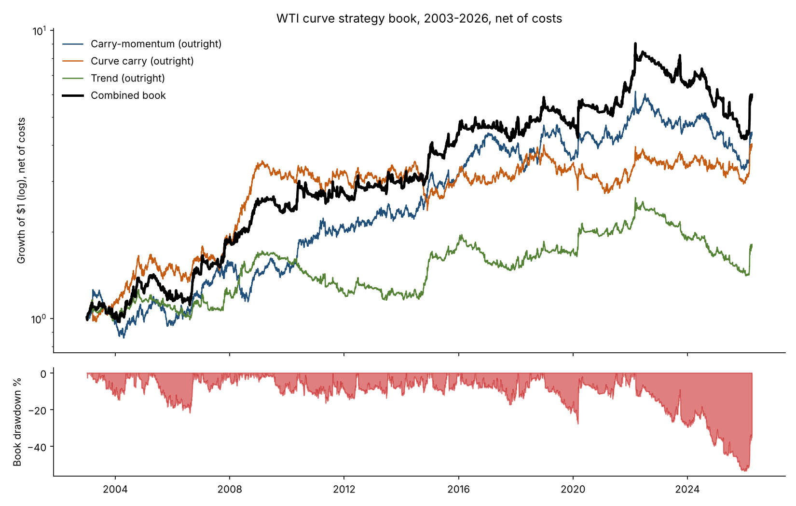
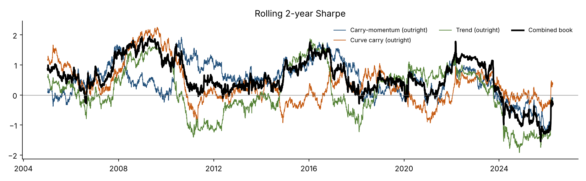

# WTI Curve Strategy Book

Three systematic WTI futures strategies, run as one risk-balanced book. Each one reads
the shape and direction of the futures curve. All figures are net of trading and roll
costs, traded in whole contracts at the next day's settlement, January 2003 to April 2026.

| Combined book | 15% vol target | 10% vol target |
|---|---|---|
| Annual return (CAGR) | **8.0%** | **5.7%** |
| Sharpe / Sortino | **0.56 / 0.74** | 0.57 / 0.76 |
| Growth of $1 | **$5.99** | $3.63 |
| Positive calendar years | **17 of 24** | 17 of 24 |
| Correlation to WTI | **-0.07** | -0.06 |
| Max drawdown | -53% | -39% |
| Best / worst month | +31% / -16% | +20% / -11% |

**The book made money in every major oil dislocation since 2003:**

| Episode | Book | Carry-momentum | Curve carry | Trend |
|---|---|---|---|---|
| 2008 crash (Jul-Dec 2008) | **+23%** | +21% | +35% | +7% |
| 2014-16 collapse (Jul 2014-Feb 2016) | **+47%** | +44% | -7% | +51% |
| COVID and negative WTI (Feb-May 2020) | **+19%** | +15% | -1% | +20% |
| Ukraine spike (Feb-Jun 2022) | **+18%** | +10% | +12% | +11% |
| 2026 supply shock (Mar 2026) | **+33%** | +26% | +25% | +26% |

It is long or short about half the time each and has essentially no correlation with the
oil price, so it adds a return stream that isn't a bet on oil going up.



## The strategies

| | Carry-momentum | Curve carry | Trend |
|---|---|---|---|
| Trades | 2nd-month outright | 2nd-month outright | 2nd-month outright |
| Signal | Is backwardation getting steeper or flatter? | Is the curve backwardated or in contango? | 1, 3 and 12-month price direction |
| CAGR (net) | 6.6% | 6.2% | 2.6% |
| Sharpe | 0.49 | 0.46 | 0.27 |
| Max drawdown | -47% | -33% | -46% |
| Positive years | 16/24 | 15/24 | 13/24 |
| Correlation to WTI | -0.11 | 0.02 | -0.05 |
| Costs per year | 0.9% | 0.2% | 0.5% |
| Position flips per year | 28 | 0.8 | 17 |
| Capacity: worst day / typical busy day* | $15M / $85M | $51M / $112M | $42M / $180M |

\*Largest book that stays within 5% of 20-day average volume and 2% of open interest in
every contract held, on the single worst day since 2003 and at the 95th percentile of
days.

**Carry-momentum** trades the *change* in the curve. When the 1-to-13-month spread
steepens into backwardation, prompt barrels are getting scarcer than the market had
priced, so the sleeve goes long; when it flattens toward contango, it goes short. It
compares today's carry with its 21-day average, so it reacts within days, and it
reacts first in a crash: the curve flips to contango before the price finishes falling.
That is why it earned +44% through 2014-16.

**Curve carry** trades the *level* of the curve. In backwardation a long position rolls
up the curve and earns the roll yield; in contango it rolls down, so the sleeve goes
short. A no-trade band means it changes sides less than once a year, which makes it the
cheapest and highest-capacity sleeve. It had the biggest single year: +74% in 2008,
short into the contango that followed the crash.

**Trend** is the standard CTA signal: the average of 1, 3 and 12-month return signs on
the rolled front contract. It earns least on its own but pays off in long moves. It made
+51% through 2014-16 and +20% through COVID, when the two carry sleeves were flat.

**Why combine them:** the carry-momentum sleeve is almost uncorrelated with curve carry
(0.03) and only loosely correlated with trend (0.29). Weighting them equally lifts the
Sharpe from 0.46-0.49 per sleeve to 0.56, and turns 13-16 positive years into 17.


## Risk: what a bad stretch looks like

The deepest drawdown ran from March 2022 to December 2025: -53% at a 15% vol target,
or -39% at 10%. After the Ukraine spike, WTI chopped between $60 and $90 for three years
while the curve flipped between backwardation and contango, so trend and carry-momentum
kept getting whipsawed:

- Over 2023-25, carry-momentum lost 38%, trend lost 37% and curve carry lost 15%.
- The book recovered 42% in the first three months of 2026 as the supply shock brought
  back a clean trend.
- The longest stretch under water was 1,023 trading days, about four years.

That episode argues for:

- **Running the book at 10% vol as one sleeve of a broader book, not at 15% on its own.**
  Returns and drawdowns scale with the target, and the Sharpe ratio does not change.
- **A drawdown rule.** Halve the size once the book is down more than twice its annual
  vol target, and restore it at a new high.
- **More markets for more breadth.** The same three signals on Brent, heating oil,
  gasoline and natural gas would diversify the single-market risk. This is the obvious
  next build.



## How it trades

- **Instrument.** NYMEX CL, the 2nd listed contract. It rolls to the next contract one
  fifth per day on business days 5-9 of the month (the GSCI schedule), so it never holds
  into delivery.
- **Timing.** Signals use day *t*'s settlement. The book trades at day *t+1*'s
  settlement with trade-at-settlement (TAS) orders and earns from *t+1*.
- **Sizing.** Each sleeve targets 15% annual vol on $10M, about 50-80 contracts. The book
  rescales the equal-weight blend to the target using trailing one-year vol. Positions
  rebalance only when the target drifts more than 25% from the current holding, or when
  the signal changes sign.
- **Costs.** $16.50 per contract per side: one tick, exchange and clearing fees, and half
  a tick to trade at settlement. Every roll is charged as a calendar spread. Total cost
  drag is 0.2-0.9% a year per sleeve.

## What didn't make the book

**Carry-momentum as a 2nd-vs-7th calendar spread.** It is the purest curve bet, but the
spread moves so little that hitting the vol target took about 375 spreads. Trading that
many cost 2.8% a year against 1.2% gross, and capacity was only about $0.3M. The signal
survives on the outright, where the same view costs under a third as much.

## Fine print

- **Parameters.** Each sleeve uses textbook parameters; none were optimised. The choice
  of these three sleeves for the book was made after seeing the four results above.
- **Trial ledger.** Including everything tried in this repository, 251 configurations are
  logged in [`results/trials.jsonl`](results/trials.jsonl).
- **Formal tests.** The pre-registered statistical study of carry-momentum, with its
  bootstrap, deflated Sharpe, PBO and factor-spanning tests, is in [NOTE.md](NOTE.md).
- **Data and curve build.** Settlements come from Datastream via WRDS, contract by
  contract. Expiries use the CME rule. The curve matches EIA's contract 1-4 prices to the
  cent on 99.6% of days ([DATA.md](DATA.md)).
- **Partial year.** 2026 runs only to 2 April, when the data ends.

```
python book.py      # -> results/book/book.json and charts (about 1 minute)
pytest -q tests
```
