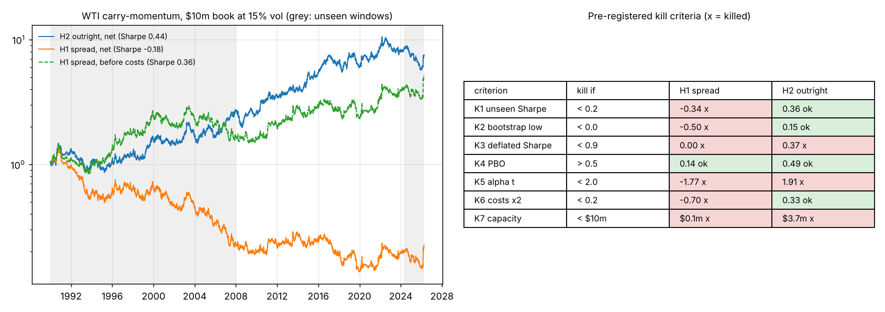

# WTI carry-momentum: the case against deploying it

**Verdict: do not deploy.** The curve version (the calendar spread) fails six of
seven pre-registered kill criteria. The outright version passes four and fails
three: its Sharpe does not survive the number of trials behind it, its alpha after
WTI's own trend, carry and basis-momentum factors is not significant, and its
capacity in the worst 1990s liquidity is under $10m. The protocol, its deviations
and every number below were committed to GitHub in that order
(`df81079` protocol, `f1b053c` curve and reconciliation, then results).



## What was tested

Bouchouev's carry-momentum (*Virtual Barrels*; OIES *Energy Quantamentals*, 2024):
carry = ln(F1m / F13m) on a constant-maturity curve, signal =
sign(carry − its 21-day mean), i.e. go with the curve when backwardation is
steepening. Two instruments, both on a $10m book at 15% volatility in whole
1,000-barrel contracts, traded at the next day's settlement, with ticks, fees, a
TAS premium and every roll charged:

- **H1, deployable:** long the 2nd listed contract, short the 7th.
- **H2, replication:** long or short the 2nd listed contract.

The sample is 1990-01 to 2026-04. 2008-01 to 2024-04 had been seen before in this
repository (as an outright on EIA contracts 2-4); 1990-2007 and 2024-04 to
2026-04 had not.

## Data, and how it was checked

515,119 daily rows for every NYMEX CL contract month from LSEG Datastream through
WRDS (settlement, volume, open interest), rather than a vendor's continuous
series. Two independent checks:

- Rebuilt contracts 1-4 match EIA's published contract series to the cent on
  99.6-99.8% of 6,000 days (pass mark 99%). Getting there exposed a Datastream
  error: three 2007 contracts carry last trading dates a month early. Expiries now
  come from the CME rule.
- The roll-scheduled series tracks the S&P GSCI Crude Oil index with daily
  correlation 0.9992 and tracking error 1.4% a year over 2016-2026, outside the
  April 2020 window when S&P changed the index's roll by hand (pass marks 0.98, 2%).

## Results

| | H1 spread | H2 outright |
|---|---|---|
| Net Sharpe, 1990-2026 | -0.18 | 0.44 |
| Seen window / unseen windows | 0.03 / -0.34 | 0.53 / 0.36 |
| 1990-2007 / 2024-26 | -0.44 / 0.36 | 0.43 / -0.21 |
| Before costs | 0.36 | 0.54 |
| Costs, % of capital a year | 8.6 | 1.6 |
| 90% bootstrap CI for Sharpe | -0.50 to 0.15 | 0.15 to 0.72 |
| Deflated Sharpe (198 trials) | 0.00 | 0.37 |
| PBO, 24 variants | 0.14 | 0.49 |
| Alpha after factors (t) | -4.8% (-1.77) | 4.8% (1.91) |
| Return from spot moves / from the curve | 0 / 5.8% | 6.7% / 1.8% |
| Capacity, worst day / 95th percentile day | $0.1m / $1.0m | $3.7m / $25m |

**The curve signal is real; the spread cannot pay for it.** Before costs the
spread earns 5.8% a year with a 0.36 Sharpe, all of it from the curve. But a
21-day carry trend flips often (about 26 times a year), a spread has a small
dollar volatility so a 15% target means 400-500 spreads, and with rolls that is
75,000 contracts a year. Costs take 8.6 points. Doubling them takes the Sharpe to
-0.70. The 7th contract was also thin in the 1990s, so the strategy could not
have been run at size then.


**The outright works, but mostly as a bet on price, not on the curve.** 6.7 of
its 8.4 points of gross return are spot moves. It replicates the earlier result
(0.53 on the seen window) and holds up before 2008 (0.43). Three things stop it:

1. **Too many trials.** Counting every WTI configuration run in this repository
   (198), a 0.44 Sharpe has a 37% probability of being skill rather than the best
   of the search. It would pass only if five or fewer configurations had been tried.
2. **Not new enough.** After WTI carry, TSMOM, basis-momentum and AQR's commodity
   TSMOM, alpha is 4.8% a year with t = 1.91. Its largest loading is on plain carry
   (0.26).
3. **The last two years.** -0.21 Sharpe from April 2024 to April 2026, a 36%
   drawdown inside that window.

**Bouchouev's mechanism is not in the data.** If storage hedgers drive the curve,
an increase in producers' and merchants' net short should deepen contango the
following week. The coefficient has the wrong sign (+0.05, t = 0.30, 1,032 weeks),
and the strategy earns less, not more, in weeks when its signal agrees with that
flow (-3.5% vs +2.4% a year).

## What this does not show

- That carry-momentum is useless. Before costs the curve signal has a 0.36 Sharpe
  for 36 years. A slower version, or one traded only when the signal is strong, may
  pay for itself; that is a new hypothesis with a new trial count, not a rescue of
  this one.
- Anything about other commodities. Factor tests used WTI time-series factors and
  AQR's TSMOM; a cross-sectional carry factor was not available (DEVIATIONS #5).

## Corrections made after results

An independent audit of the code found no look-ahead (re-running with all data
cut at three dates leaves every earlier return unchanged) and six issues, all
corrected and listed in DEVIATIONS #8. The one that mattered: the novelty factors
had been built net of costs, which flattered alpha. Built gross, as published
factors are, H2's t-statistic fell from 2.06 to 1.91 and K5 changed from pass to
fail. No correction changed a deployment verdict.

## Live test

The rules are frozen at tag `carry-momentum-frozen-v1`. A three-month paper trade
cannot rescue a strategy that failed on 36 years of data. What it can still test is
whether fills at TAS land within two ticks of settlement, which the backtest
assumes. Expected 63-day return of H2 from the stationary bootstrap: median +1.3%,
5th percentile -10.9%, 95th +15.4%.

## Reproduce

```bash
pip install pandas numpy pyarrow arch statsmodels matplotlib xlrd openpyxl
# data/ as described in DATA.md (WRDS access needed for the contract file)
python reconcile.py   # data checks
python study.py       # every test and the kill criteria -> results/study.json
python figures.py
pytest tests -q
```

The deflated Sharpe, PBO and spanning test come from the capstone validation
library (`quant-pipeline-testbed/capstone`), expected next to this repository.
